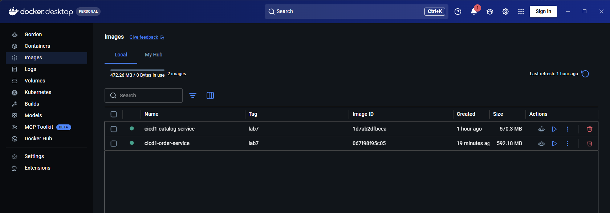

# CICD-1 Lab 1 | Order Service
Allows client to add new order with an id referring to a product from the catalog service and see a list of all the current orders.

Endpoints: GET /orders, POST /orders

Uses port 8082

Link to Order repository: [Here](https://github.com/RonsJose/cicd1-catalog-service)

## SQL and Normalisation Lab
Final db<>fiddle session: [https://dbfiddle.uk/tHIGk2_6](https://dbfiddle.uk/tHIGk2_6)

The fiddle contains completed SQL queries and the written answers as SQL comments.

## Docker
* The maven package must run before build with the Dockerfile is used, because the dockerfile copies an already built JAR file. Without running the maven package there will be no JAR file in the target folder for the dockerfile to create an image from.

* An image is a reusable package. A container is a running instance created from that package. You may create more than one container from the same image.

* 8082:8082 Maps the host port from my pc to the docker container port 8082, which means it forwards the traffic from port 8082 from my pc to the container port 8082. EXPOSE is documentation that lets you know which port the container is listening on, it doesn't do any mapping or publishing. So no it does not alone make the application accessible from windows.

* It will fail because that address means the order container itself, not the catalog container.

* It survived after docker compose down, because it used a named volume to store the h2 database outside the container, so the data persists even if the container is deleted. And when a new container is created using up -d it reattaches to the named volume to use the data. The data would be lost in an in memory h2 database since it is stored in the container, when the container is deleted the data is gone with it.

  

The catalog product id was 1 and the name was "This will be saved in a vouyme outside the container", for the one I retrieved after docker compose down and docker compose up -d.
